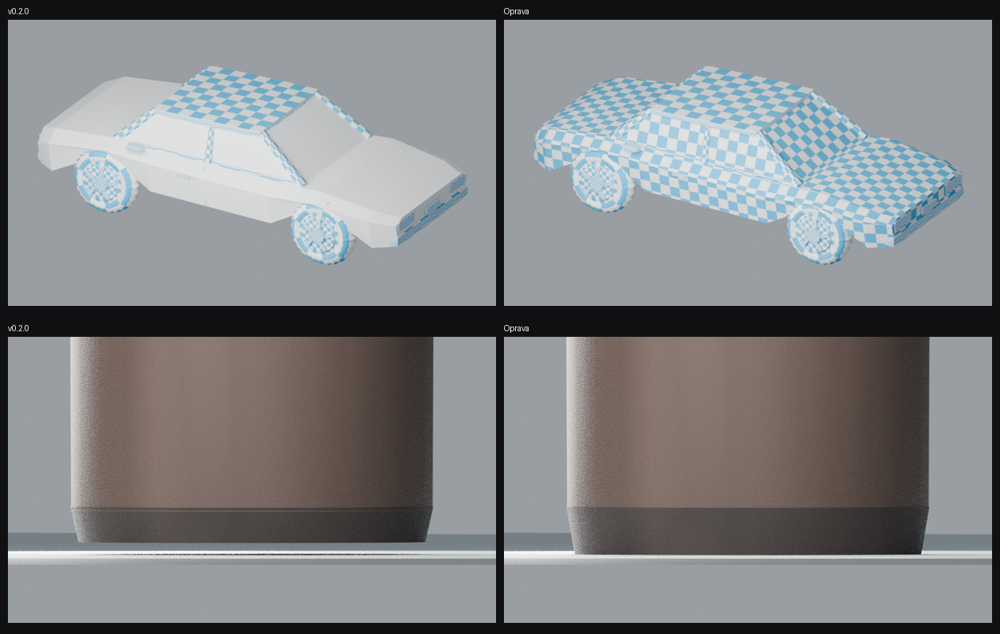
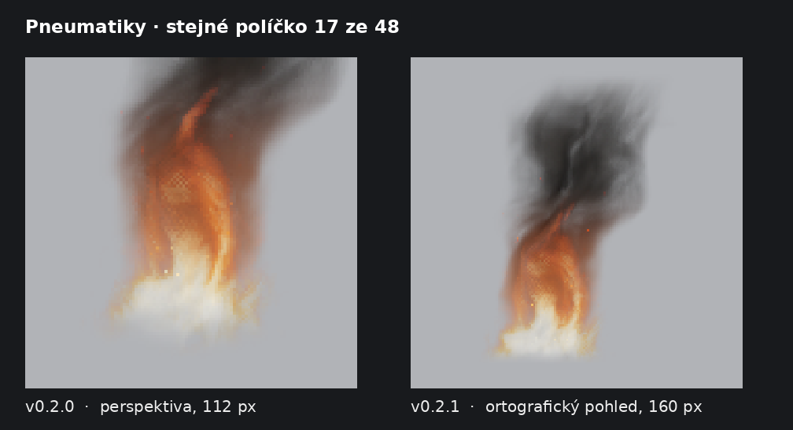

# Oponentura Fire Asset Lab · 28. listopadu 2026

Výchozí verze byla `f66833c` (v0.2.0). Kontrolovanou jednotkou byl rozbalený distribuční ZIP, který dostane autor hry. Oponentura geometrie proběhla samostatně v Blenderu před úpravou generátoru. Hodnocení níže spojuje vývojové a výtvarné perspektivy. Konzilium je strukturovaná technická oponentura podle profesních rolí.

## ExpertiKonzilium

| Pohled | Otázka a doložený nález ve v0.2.0 | Zásah |
| --- | --- | --- |
| VFX výtvarník | Co se stane se siluetou na světlém pozadí? V 601 z 816 polí měla krajní řada nebo sloupec alespoň jeden pixel s alfou nad 32/255. U pneumatik dosáhla až 253/255. Kouř končil ostrým řezem. | Samostatná přední ortografická kamera obsáhne efekt po celou animaci. Vyšší rozlišení buněk kompenzuje vzdálení pohledu. |
| Autor 3D geometrie | Přijme model běžnou opakovanou texturu? Na karoserii a skle mělo 100 trojúhelníků v každém LOD nulovou UV plochu. Jednobarevný materiál to v prohlížeči skryl. | Projekce panelů má orientované souřadnice v metrech. Stejná oprava pomohla i panelům ohniště, domu a sudu. |
| Integrátor enginu | Kde je podlaha? Patka lahve visela ve všech třech LOD 18 mm nad počátkem. Na pólech byly trojúhelníky s nulovou plochou. | Patka dosedá do y = 0 a generátor odstranil 16, 32 a 56 nulových trojúhelníků podle LOD. Také podlaha webové scény se posunula z −13 mm na společnou nulu. |
| Autor materiálů | Dá se oddělený plamen spolehlivě složit s modelem? Perspektivní atlas uváděl jen údaj „orbit“. Odběratel musel odhadnout velikost i ukotvení. | Manifest obsahuje rozměry v metrech, směr pohledu, střed roviny a souřadnice počátku modelu v buňce. |
| QA a uživatel laboratoře | Mohla kontrola projít i bez dodávaného ZIP? Ano. V UI navíc dokončení pomalého exportu mohlo znovu spustit mezitím pozastavenou studii. Po obnovení kontextu WebGL aplikace stále ukazovala náhradní snímek. | Chybějící balík je nyní chyba kontroly. Export zachovává aktuální volbu přehrávání. Při návratu WebGL se obnoví stav vybrané scény, profil a ovládání. |

V galerijní studii tmavý kouř pneumatik na tmavém pozadí splýval s okolím. Studie pneumatik a auta proto nyní ukazují celý sloup ve světlém studiu. Stejné pozadí lze v inspektoru zapnout u ostatních scén. [Opravená studie pneumatik](public/renders/studies/tire-ash.webp)

## 5Why · proč minulá kontrola schválila useknutý kouř?

1. **Proč byl řez patrný ve hře?** Na krajních pixelech billboardu zůstal viditelný kouř. Mimo plochu billboardu už žádné pixely nejsou.
2. **Proč kouř dosáhl až na okraj?** Export převzal perspektivní záběr, který v prohlížeči zvýrazňoval zdroj ohně.
3. **Proč galerie chybu skryla?** Náhled používá tmavé pozadí a jiný poměr stran. Snímek se hodnotil jako kompozice celé scény.
4. **Proč prošel exportní test?** Kontroloval typ a rozměry PNG, existenci alfa kanálu a manifest. Pokrytí krajních texelů neměřil.
5. **Proč tento test chyběl?** Akceptační podmínky končily vytvořením souboru. Neobsahovaly jeho použití jako herní vrstvy na cizím pozadí.

Nový regresní test čte každou buňku každého atlasu. Kontroluje viditelný obsah celého klipu a na všech hranách dovolí nejvýše 2/255 alfy. U jednorázových efektů může být úvodní políčko prázdné. Samostatná zkouška v Godotu porovnává průsvitné pixely na černém i bílém podkladu.

## MentalModels · jak jsme rozhodovali

- **Inverze.** Místo otázky „vypadá oheň dobře?“ jsme hledali podmínku, za které se porucha projeví nejvíc. Kontrolní šachovnice odhalila zkolabované UV a bílý podklad zvýraznil špatně zpracovanou alfu kouře.
- **Zachování měřítka.** Stejný počátek musí ukazovat na stejné místo ve světě při výměně LOD i při nasazení billboardu. Kontrola převádí pivot z UV zpět do metrů. Funguje také pro svíčku, jejíž plamen leží vysoko nad počátkem modelu.
- **Oddělení příčiny a příznaku.** Přidání trojúhelníků by nerozvinulo zhroucené UV a větší PNG se stejným záběrem by přesněji zachytilo stejný řez. Opravili jsme projekci a kompozici před dalším renderem.
- **Cena přesnosti.** Vzorek s milionem trojúhelníků prokazuje rozsah importu. Plynulost hry závisí také na počtu překreslených průhledných pixelů, rozlišení a ovladači. Softwarový renderer sloužil ke kontrole obrazové shody. Pro rozhodnutí o výkonu zbývá měření na fyzických GPU.

## ELI20 · co si z toho vzít při importu

Plamen v atlasu je série průhledných obrázků na obdélníku. Pokud kouř dojde až k okraji jednoho obrázku, ve hře uvidíš rovnou hranu i po zvětšení textury. Nový export ponechá kolem efektu průhledný prostor. Velikost obdélníku v metrech a bod, který má přijít k počátku modelu, najdeš v manifestu. U krátkého jednorázového efektu vybírej políčko podle jeho uloženého času. První část klipu má více snímků za sekundu.

U 3D modelu pracuješ také s UV souřadnicemi. Určují, který kus textury patří na který trojúhelník. Když se všechny tři souřadnice sejdou v jednom bodě, i velký plech auta dostane jedinou barvu. Proto má kontrolní render karoserie střídavě světlé a tmavé čtverce.

## Naměřené výsledky v0.2.1

| Kontrola vydaných souborů | Výsledek |
| --- | --- |
| 17 atlasů, 48 buněk v každém | 816 z 816 buněk mělo všechny krajní pixely s alfou přesně 0. Před opravou byla nejvyšší krajní alfa 253/255. |
| Blender 4.3.2, všech 48 GLB | U každého modelu souhlasil počet trojúhelníků a převod z +Y do +Z. Importované trojúhelníky měly nenulovou geometrickou i UV plochu. |
| Godot 4.7.2 Compatibility, OpenGL přes Mesa llvmpipe | Tři GLB a tři atlasy prošly standardním importem. Ve skutečném 3D renderu nad černou a bílou nepřesáhla maximální odchylka žádného kanálu 4/255. V čase 0,4 s připadl svíčce i pneumatikám index 2, jednorázovému efektu index 13 podle `frameTimes`. |
| Kontrola distribuce | 45 scénických GLB, 3 vzorky uhlí, 136 konfigurací, 17 atlasů a 48 snímků. Ověřena integrita ZIP a shoda snímků galerie s archivem. |
| Webová aplikace | Produkční sestavení prošlo. V jednotkovém testu se simulovaným rendererem zůstala nově vybraná studie po exportu pozastavená a po ztrátě a obnově WebGL se aktivovala aktuální scéna. Interaktivní průchod přes službu Sites blokoval timeout zpřístupnění portu 4173. |

**Výtvarné omezení.** Ve světlém studiu dobře vystoupí silueta kouře, ale téměř hladký vosk a zjednodušená karoserie jsou při pohledu zblízka stále rozpoznatelné jako procedurální modely. Vydaný atlas také poskytuje jediný pohled. Při obcházení efektu je vhodnější živý objem. Na fyzickém T460 a současné herní grafice zůstává potřeba změřit časy snímků.

## Reprodukce

- `npm ci && npm run check` dekóduje PNG, kontroluje hrany všech buněk, časové údaje a geometrii GLB po importu. Ověří také shodu distribučních snímků a manifestů s repozitářem.
- `node scripts/check-godot.mjs` vyžaduje Godot 4 s OpenGL a grafický výstup. Cestu k jiné binárce nastav přes `GODOT_PATH`. Skript rozbalí tři scény do nového pracovního adresáře, provede skutečný import modelů a textur, sestaví billboard z hodnot manifestu a porovná každý pixel s nezávislým výpočtem pro přímou alfu. Výsledné snímky na obou pozadích zůstanou v daném adresáři.
- `npm run bake && npm run check && npm run build` znovu vytvoří celou distribuci. Bake používá Chromium, jeho cestu lze zadat v `CHROMIUM_PATH`.
